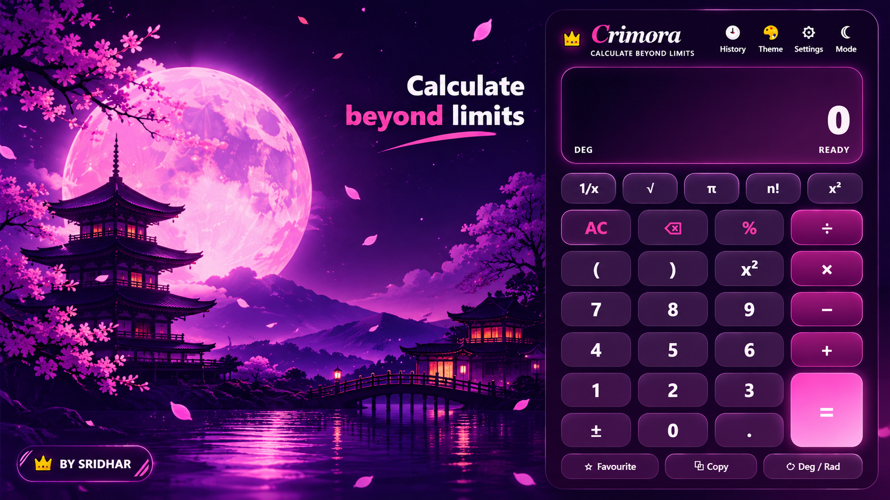

<div align="center">

# 👑 Crimora

### *Calculate beyond limits.*

A stylish, anime-inspired scientific calculator in **one single HTML file**.
No installs. No dependencies. Just open and calculate. 🌸

<p>
  
  
  
  
  
</p>



</div>

---

## ✨ Features

| | |
|---|---|
| 🎨 **6 Themes** | Crimson Edge, Sakura Bloom, Neon Cyber, Violet Dream, Slate and Aurora |
| 🌗 **Light / Dark mode** | One tap to switch |
| 🖼️ **Custom wallpaper** | Upload your own image. Choose Fill or Fit, plus a focus point |
| 🫧 **Glass UI** | Adjustable transparency and panel blur so your wallpaper shines through |
| 🌸 **Falling petals** | Soft animated petals in the theme colour |
| 🕘 **History and Saved** | Revisit recent results and star your favourites |
| 📐 **Deg / Rad** | Switch the angle unit for sin, cos and tan |
| 📳 **Haptics** | Optional vibration on tap for mobile |
| ⌨️ **Keyboard input** | Type your calculations directly |
| 💾 **Remembers you** | Preferences are saved in your browser |

---

## 🚀 Quick Start

```bash
git clone https://github.com/TELEX2009/crimora.git
cd crimora
```

Then open **`index.html`** in any modern browser. That's it. 🎉

### 🌐 Host it free on GitHub Pages

1. Go to **Settings → Pages**
2. Choose **Deploy from a branch** and select `main` / `root`
3. Your calculator goes live at `https://TELEX2009.github.io/crimora`

---

## 🖼️ Setting a Wallpaper

Open **Theme → Wallpaper** and pick an image.

- **Fill / Fit whole** — cover the screen or show the full image
- **Left · Center · Right** and **Top · Center · Bottom** — choose the focus point
- **Wallpaper dim** — lighten or darken the image
- **Panel blur** and **Transparency** — see more of your photo through the panels

> 🔒 Wallpapers are resized to 1600px and stored **only on your device**. Nothing is uploaded anywhere.

---

## 📱 Responsive

| 🖥️ Desktop | 📱 Mobile |
|---|---|
| Three columns: decor, calculator, side panel | One column with the side panel as a bottom sheet |

---

## 🗂️ Project Structure

```
crimora/
├── index.html   # the whole app (HTML + CSS + JS)
├── desk.png     # preview screenshot
├── LICENSE
└── README.md
```

---

## 🤝 Contributing

Ideas and pull requests are welcome!

1. 🍴 Fork the repo
2. 🌿 Create a branch: `git checkout -b feature/cool-idea`
3. 💾 Commit your changes
4. 🚀 Open a pull request

---

## 📜 License

Released under the **MIT License**. Free to use, modify and share. See [`LICENSE`](LICENSE) for details.

---

<div align="center">

Made with 💖 and a lot of ☕

**If you like Crimora, drop a ⭐ on the repo!**

</div>
